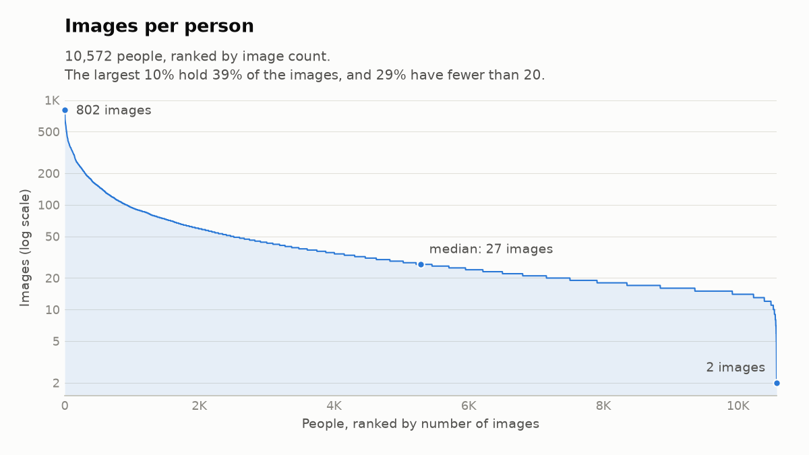

# CASIA-WebFace datasheet

The data every model in this project trains and tests on. Counts come from `plot_long_tail.py`
and `find_duplicates.py`, run on the manifest.

## Source and licence

- **Collection:** photos of celebrities born 1940–2014, taken from their IMDb galleries
  ([Yi et al., 2014](https://arxiv.org/abs/1411.7923)). Faces were matched to people by a face
  matcher and each photo's name tags, then checked by hand. People with fewer than 15 faces were
  dropped. The paper reports 10,575 people and 494,414 images.
- **This copy:** InsightFace's 112×112 aligned version, mirrored on Hugging Face as
  `SaffalPoosh/casia_web_face` at revision `0886313`. It has 10,572 people and 490,592 images,
  split by person into 9,072 train, 500 val and 1,000 test (`splits/casia.csv`).
- **Licence:** CBSR (Chinese Academy of Sciences) releases CASIA-WebFace only to institutions
  that sign an agreement, for research and education. The mirror states no licence. Treat it as
  non-commercial research only: don't redistribute the images or publish faces, and treat models
  trained on it as carrying the same restriction.

## Images per person

Median 27, mean 46, from 2 to 802. The largest 10% of people hold 39% of the images, and 29%
have fewer than 20. Train, val and test look the same. The drop at the right: this copy has
3,822 fewer images than the paper, so 659 people are now below its cut-off of 15.

Training draws every image equally, as published face-recognition recipes do. Evaluation uses
at most 20 photos per test person, so the people with the most photos don't dominate the score.

## Label noise

- **Wrong person:** [Wang et al. (ECCV 2018)](https://arxiv.org/abs/1807.11649) checked 30
  CASIA people by hand and estimated that 9.3–13.0% of images are mislabelled.
- **Exact copies** (same sha256): 2,491 images are stored more than once, in 5,023 rows. Most
  are the same photo twice under one person. That includes 232 in test, so a few genuine test
  pairs compare a photo with itself.
- **Copies under two people:** 65 images, linking 21 pairs of people.
  - 9422 and 9423 share 24 images, and 10477 and 10478 share 18. Each is probably one person
    under two IDs, so training pushes apart two classes of the same face. A third pair shares 3.
    All are in train.
  - 6 pairs cross splits: 6 test images and 1 val image are byte-for-byte copies of a training
    image filed under someone else.
- **Not found yet:** resized or re-encoded copies, and one person under two IDs with no shared
  file. Both need a face model (M2).

These are left in place, because the split and images must match the earlier project for its
numbers to line up. They are small: 7 of the 68,501 val and test images, and 2 or 3 of the
9,072 training people.

## Demographic skew

- CASIA has no demographic labels, so this project can't measure skew itself. The RFW authors
  ([Wang et al., ICCV 2019](https://arxiv.org/abs/1812.00194)) estimated its photos as 84.5%
  Caucasian, 11.3% African, 2.6% Asian and 1.6% Indian.
- They measured the effect too: ArcFace trained on CASIA scored 92.2% on RFW's Caucasian pairs
  and 84.0–88.0% on the other three groups.
- The photos are press and film shots: mostly posed and professionally lit. Expect worse
  results on phone selfies than the benchmarks suggest.

## Overlap with benchmarks

- **LFW, CALFW and CPLFW:** the CASIA authors removed 1,043 people whose names matched LFW's.
  CALFW and CPLFW reuse LFW's people, so they're covered too. Name matching misses anyone listed
  under another name.
- **CFP-FP and AgeDB-30:** also celebrities, with no published overlap check, so some overlap
  is likely.
- **Why it matters little here:** the benchmarks are only a sanity check against published
  numbers, which come from models trained on the same CASIA, so any overlap flatters both
  equally. The main results come from CASIA's own test people.
